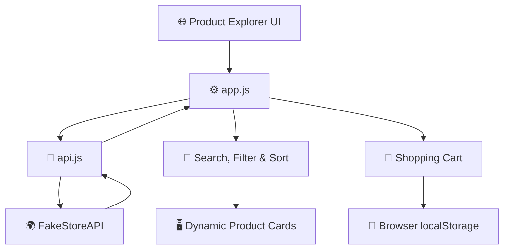

 
<div align="center">

# ⚡ Dynamic JavaScript DOM Logic & RESTful API Client


<p>
  
  
  
  
</p>

### ✨ An interactive product explorer powered by JavaScript and a REST API

[🚀 Live Demo](https://dynamic-js-api-client.onrender.com/) · [💻 Source Code](https://github.com/sania28/dynamic-js-api-client)

</div>

---

## 🌈 About the Project

**Dynamic JavaScript DOM Logic & RESTful API Client** is a responsive product explorer built using modern JavaScript. It fetches real product data from an external API and allows users to search, filter, and sort products dynamically.

The project demonstrates API integration, DOM manipulation, asynchronous JavaScript, client-side cart persistence, and error handling.

## 🚀 Features

<table>
<tr>
<td width="50%">

### 🔎 Live Search
Search products by name as you type.

### 🗂️ Category Filtering
Filter products by their category.

### ↕️ Product Sorting
Sort products using the available sorting options.

</td>
<td width="50%">

### 🛒 Shopping Cart
Add products to the cart and retain cart entries.

### 💾 Local Storage
Keep cart data saved in the browser.

### ⚡ Loading & Error States
Display loading skeletons and helpful error messages.

</td>
</tr>
</table>

- 📱 Responsive layout for different screen sizes
- 🔄 Fetch API for asynchronous data retrieval
- 🧩 Modular JavaScript with separate API logic
- 🛡️ API response validation and retry support

## 🛠️ Tech Stack

<p>


</p>

## 🏗️ Project Architecture



## 📁 Folder Structure

```text
dynamic-js-api-client/
├── index.html      # Main application structure
├── style.css       # Responsive styling and loading states
├── api.js          # Product and category API functions
├── app.js          # DOM logic and application state
└── README.md       # Project documentation
```

## 🌍 API Integration

This project uses the public [FakeStoreAPI](https://fakestoreapi.com/) to retrieve product information.

| Endpoint | Purpose |
|---|---|
| `/products` | Fetch product details |
| `/products/categories` | Fetch product categories |

## 💻 Run Locally

**1. Clone the repository**

```bash
git clone https://github.com/sania28/dynamic-js-api-client.git
```

**2. Open the project folder**

```bash
cd dynamic-js-api-client
```

**3. Start a local server**

```bash
python3 -m http.server 8000
```

**4. Open in your browser**

Visit `http://localhost:8000`.

> A local server is recommended because the application uses JavaScript modules.

## 💾 Client-Side Persistence

Cart entries are stored in browser `localStorage` under the key:

```javascript
productExplorerCart
```

This keeps saved cart entries available across page reloads in the same browser. The project uses browser-side storage and does not use a backend database for cart persistence.

## ✅ Project Checklist

- [x] REST API integration
- [x] Dynamic DOM rendering
- [x] Product search
- [x] Category filtering
- [x] Product sorting
- [x] Cart entry persistence with localStorage
- [x] Loading and error handling
- [x] Responsive design
- [x] Live deployment

## 🚀 Live Deployment

**Live Application:** https://dynamic-js-api-client.onrender.com/

**GitHub Repository:** https://github.com/sania28/dynamic-js-api-client

## 👩‍💻 Author

**Sania Mujtaba**

- GitHub: [@sania28](https://github.com/sania28)
- LinkedIn: [Connect with me](https://www.linkedin.com/in/sania-mujtaba-20806a394/)

---

<div align="center">

### 💙 Built with JavaScript, curiosity, and continuous learning.


</div>

